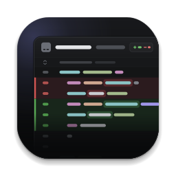

<p align="center"></p>

# Onceover

Give your agent's work a once-over. A minimal, beautiful local diff viewer: run `onceover` in a repo or worktree and review everything the branch would ship, in one stacked view, against `main`. Leave comments on lines, press Done reviewing, and paste the feedback straight back into Claude Code.

Status: in development. See `docs/SPEC.md`.

## Try the demo

[Open the live demo](https://onceover-demo.vercel.app) to try Onceover without installing anything. It's the real app on a made-up branch of a rideshare app, with one of every kind of change: renames, deletions, a binary image, a lockfile, a mode change, a submodule and a file too big to show at once. Leave comments, mark files viewed, switch the base, press Done reviewing, and use the demo bar to play an agent's edits and watch the page keep up. Everything stays in your browser.

## Running it

```
npm install && npm run build && npm link   # once, from this checkout
onceover                                   # in any repo or worktree
onceover --base dev --port 5000 --no-open
```

`onceover` serves the review on `127.0.0.1` and opens your browser. The page follows the repo as the agent works: edits, new files, commits and branch switches show up on their own, and the stack keeps your place. Press Ctrl+C to stop. Each worktree gets the same port every run, so a tab left open picks the new run back up instead of opening another one.

## Development

- `npm start` runs the CLI from source against this checkout. `npm run dev` serves the UI with hot reload and proxies `/api` to a server started with `npm start -- --no-open --port 47000`.
- The design playground lives at `playground.html` (`npm run dev`, then open `/playground.html`).
- `npm test` runs the git core, server and CLI tests against throwaway repos (Node 22.18 or later).
- `npm run typecheck` checks both the UI and the Node code.
- `npm run demo` serves the demo locally, and `npm run build:demo` builds it into `dist/demo`. Its data comes from `scripts/demo-data.ts`, which runs the real git core over a throwaway repo; the page answers the API from that data in the browser (`ui/src/demo`).
